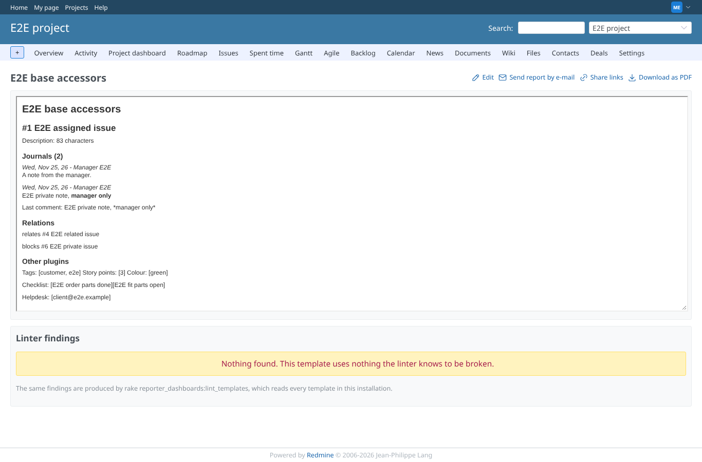
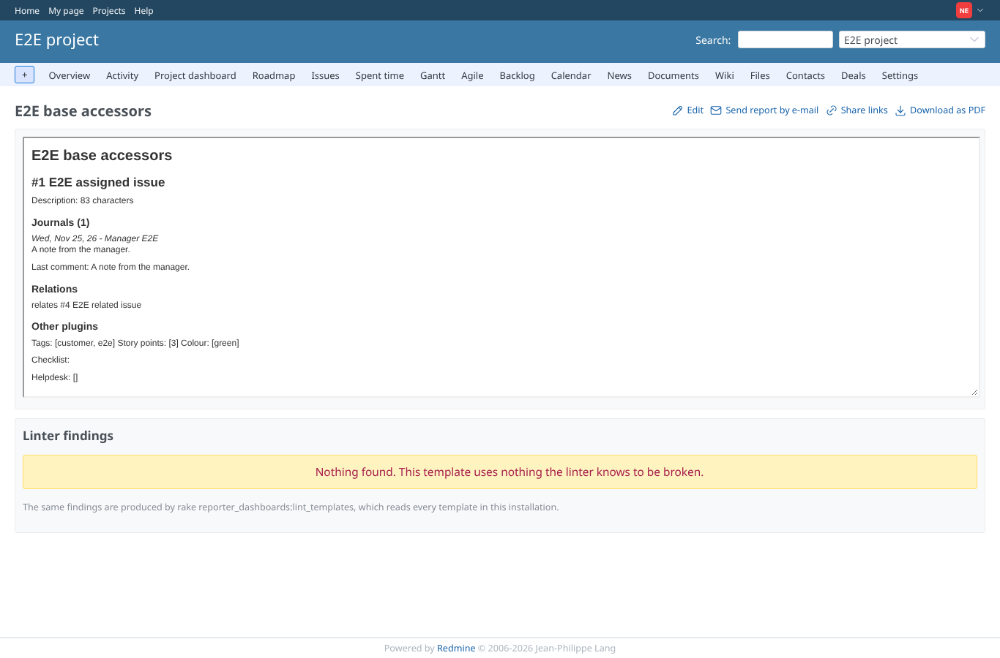
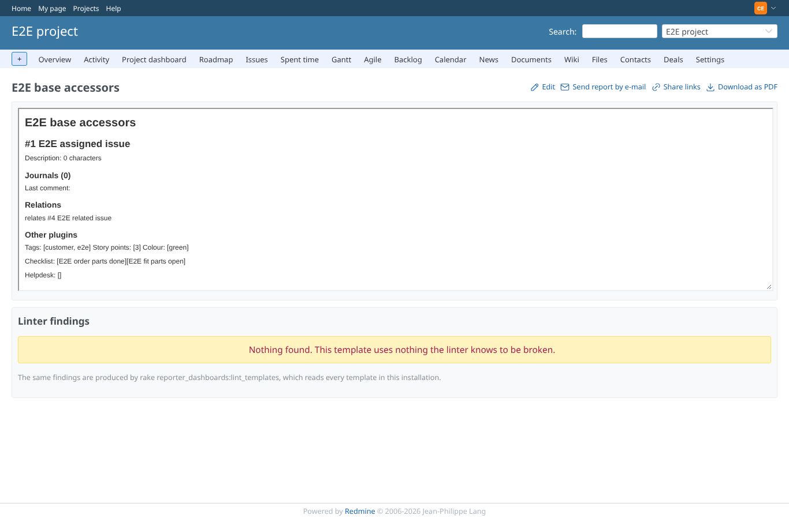
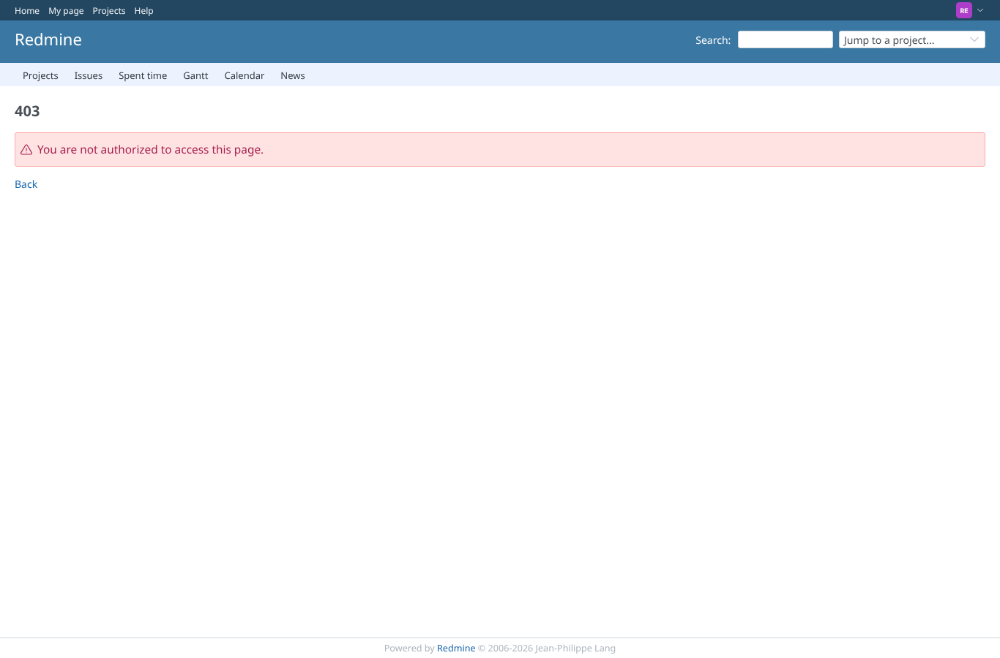

# base_accessors

Run 2026-11-25T17:21:42.508Z against http://127.0.0.1:3000.

| screenshot | user | URL | shows |
|---|---|---|---|
|  | manager | `/projects/e2e-project/reporter/templates/6` | Manager (every permission): both notes, the private one too; both relations; tags, story points, colour, checklist and helpdesk ticket where those plugins are installed |
|  | notesless | `/projects/e2e-project/reporter/templates/6` | Member without "View private notes", checklists or helpdesk: the public note only, no relation into the private project, no checklist, no ticket |
|  | closed | `/projects/e2e-project/reporter/templates/6` | Member who may see but not open the issue (redmine_view_issue_description): no description and no journals |
|  | reporter | `/projects/e2e-project/reporter/templates/6` | Reporter without the report permissions: the template is refused (403) |
