# UX review, November 2026: design mockups

Before/after screenshots for six findings, on a real **Redmine 7.0-stable-GEOxyz** (578730a,
Rails 8.1, Ruby 3.3.6, PostgreSQL 16, production mode, Chromium) with this plugin at
`redmine70-migration`. Mockups only: **no plugin code changed**.

- **Before** is the real page.
- **After** is the same real page with a mockup layer injected by Playwright
  ([`mockup/`](mockup/)). The layer restyles, moves and rewrites the page's DOM, and adds
  elements (a tab bar, headings, foot lines, links) built only from Redmine's own idioms:
  core `.tabs`, `.contextual`, `em.info`, `p.nodata`, `p.warning`, `.box.tabular`,
  `table.list`, `.mypage-box`, sprite icon ids. Only **Redmine 7.0** was run; the markup
  used also exists on 6.x, but that is not tested here.
- Data: 45 issues (3 trackers, 5 statuses, 4 priorities, 6 assignees, 3 versions), 49 time
  entries, 5 templates made from `starters/`, public queries, 4 sent reports, and a 3-tab
  dashboard (Overview, Charts, Versions) whose rows hold 1, 2 and 3 widgets.
- Users: `manager` (every permission), `viewer` (core Reporter + the plugin's view
  permissions, no edit rights, own time entries only), `admin`.
- Screenshots: 1440 wide, deviceScaleFactor 2, PNG quantised to 256 colours.

**Constraints:** no change to permissions, visibility or what data anyone sees, unless named
below as a decision for Jan; no page slower; English wording here, translations later.

## Final design

Every proposal applied together, on every page, for both navigation variants. Each image is
**Before | After A (one tab bar, recommended) | After B (two levels)**, 1440 px per panel.
The single shots are next to them in [`img/final/`](img/final/) (`<page>-before.png`,
`-a.png`, `-b.png`).

**Manager (all permissions)**

| Page | Composite |
|---|---|
| Dashboard, Overview (rows of 1, 2, 3 widgets) | [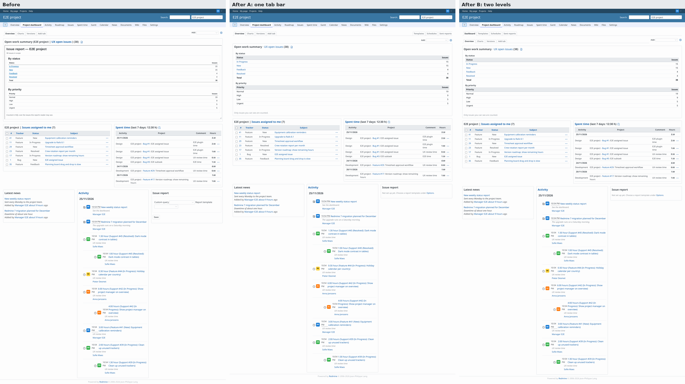](img/final/dashboard-overview.png) |
| Dashboard, Charts (charts 3 per row in a wide widget, 1 per row in narrow ones) | [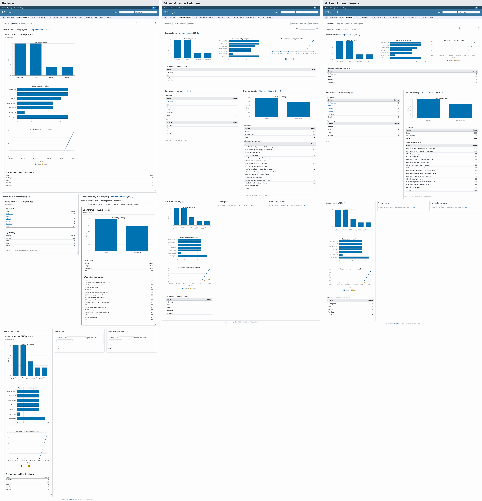](img/final/dashboard-charts.png) |
| Dashboard, Versions | [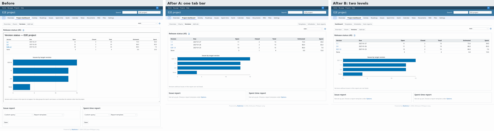](img/final/dashboard-versions.png) |
| Templates | [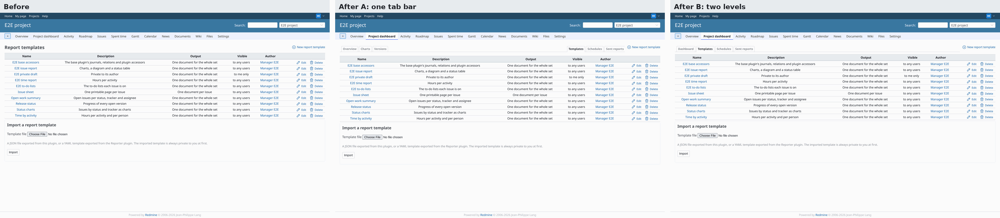](img/final/templates.png) |
| New template | [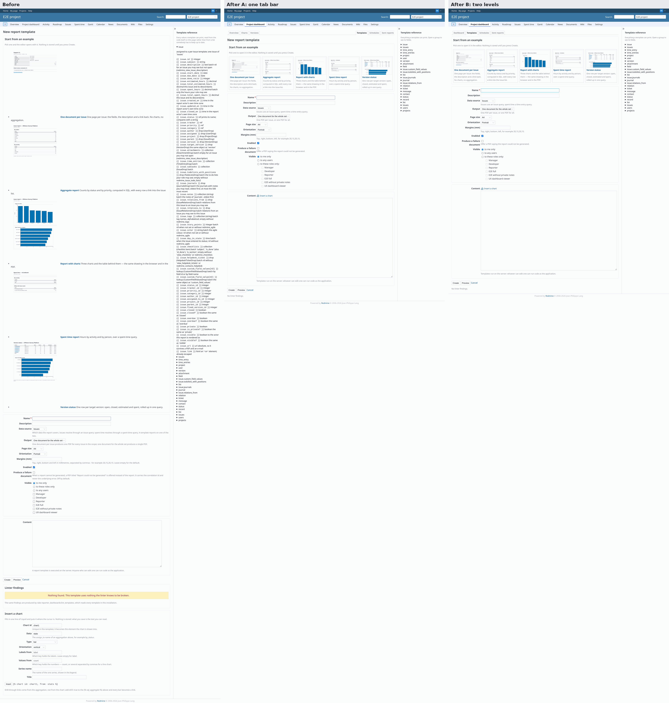](img/final/template-new.png) |
| Template page | [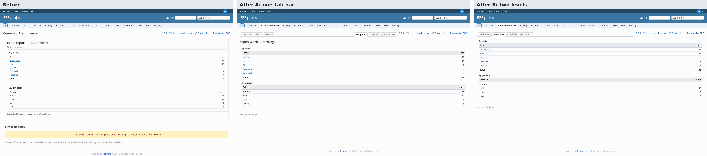](img/final/template-show.png) |
| Schedules (project member) | [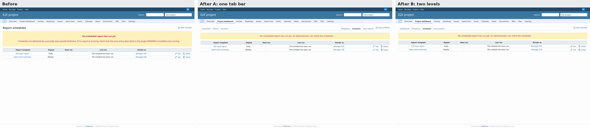](img/final/schedules.png) |
| Schedules (administrator) | [](img/final/schedules-admin.png) |
| Sent reports | [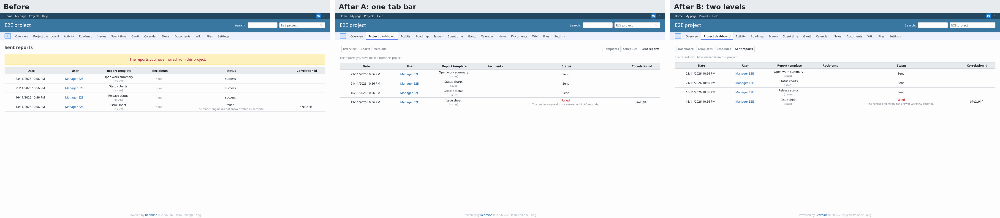](img/final/sent-reports.png) |
| Project settings (plugin tab removed, choice 1c) | [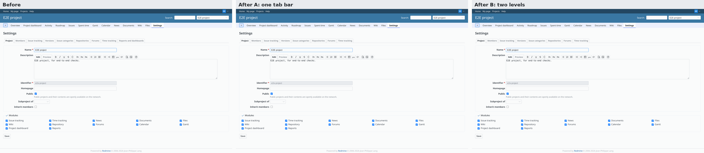](img/final/settings.png) |
| Dashboard controls at 1100 px | [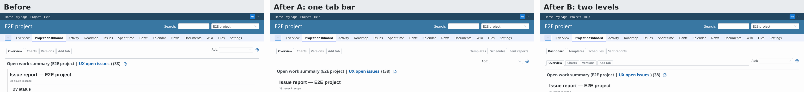](img/final/controls-1100.png) |

**Reader without edit rights (`viewer`)**

| Page | Composite |
|---|---|
| Dashboard, Overview | [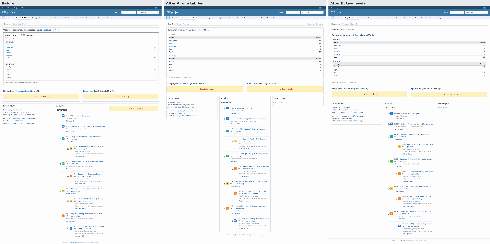](img/final/reader-overview.png) |
| Dashboard, Charts (S-14 notice stays) | [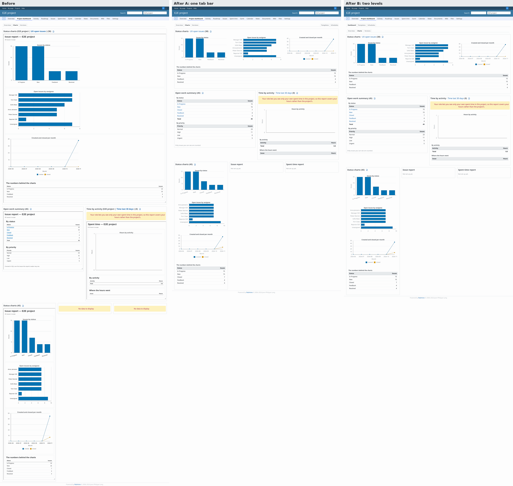](img/final/reader-charts.png) |
| Templates | [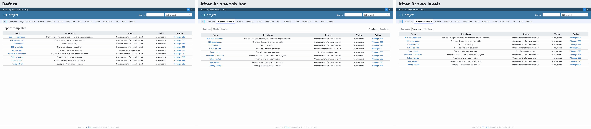](img/final/reader-templates.png) |
| Template page | [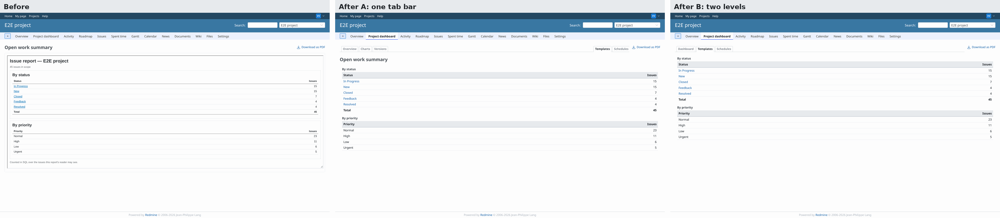](img/final/reader-template-show.png) |
| Schedules | [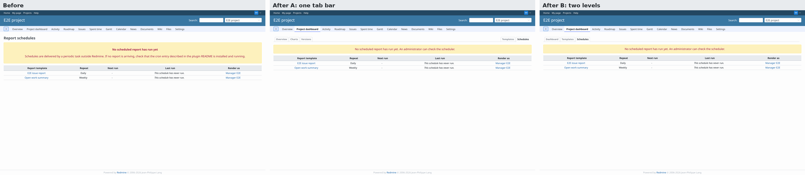](img/final/reader-schedules.png) |

What the final pages add to the per-finding shots below:
- **Dashboard controls.** Variant A: "Add:" and the gear get their own right-aligned
  `.contextual` line under the tab bar, so they never crowd Templates | Schedules | Sent
  reports, also at 1100 px. Variant B: they sit on the dashboard's own (second) tab row.
- **Charts in widgets.** Chart cards side by side: 3 per row from 1100 px widget width, 2 from
  720 px, else 1; a single chart is at most 720 px wide; 230 to 240 px high. Axis, legend and
  title text 12 to 13 px Noto Sans, ticks and legend grey `#868e96` (core `em.info` grey),
  chart title `#495057`, grid lines `#e9ecef`.
- **Scope line in plain words:** "Only issues you can see are counted." (and "Only time
  entries you can see are counted.", "Versions without issues in this report are not
  listed."). These lines are template text, so the change is in `starters/*.liquid`.
  Caveat: in a document rendered as another user (a schedule's "render as", a share link)
  "you" is not the reader; there the starter should name the render actor ("Only issues
  Manager E2E can see are counted."). Proposed wording on screen: **"Only issues you can see
  are counted."**
- **"Visible" as core's query form** (`app/views/queries/_form.html.erb:20-29, :118-121`): to me
  only, to any users, to these roles only:, then the roles indented (`label.block.role-visibility`)
  and disabled until "to these roles only" is chosen.
- **Lint, no findings:** one plain grey line "No linter findings.", without the rake command
  (authors are not admins). This changes D4: `lint_panel_test.rb:281-285` asserts the task
  name on the page and must change with it.

## Summary

| # | Finding | Proposal in one line | Effort | Queries |
|---|---|---|---|---|
| 1 | Templates, Schedules, Sent reports only reachable via Settings | One menu item, one core tab bar on all four pages | 1.5 d | +1 small on 3 pages; settings page lighter |
| 2 | Yellow boxes used for explanations | Yellow only for no-data and real warnings; help as `em.info` | 0.5 d | none |
| 3 | Dashboard widgets heavy and noisy | No inner frames, Redmine table idiom, one title, charts at widget width, quiet empty states | 3 d | none (fewer for editors with an on-demand form) |
| 4 | "New report template" is 4535 px | Starter cards in a grid, reference collapsed, chart helper as a button, large editor, clean lint as one line | 1.5 d | none |
| 5 | Plugin settings full of internal jargon | One short line per field; engine table in words | 0.5 d | none |
| 6 | Permission labels too long | Shorter labels that keep the warning | 0.5 d | none |

Total about **7.5 days** including locales (12 files), tests and the four-role review.

## Decisions this reopens (report-and-ask, CLAUDE.md §11)

These are not plain UX calls: each one reverses a recorded decision or a spec control.

| # | What | Recorded where | What the proposal does |
|---|---|---|---|
| D1 | Templates and Schedules live under Project settings, one entry point per page | Curator decision 2026-08-21 (`init.rb:136-152`, `settings_tab.rb:7-11`) | Moves them to the project menu item's tab bar; Settings tab removed (choice 1c) |
| D2 | The Settings tab is the way in for roles without the dashboard permission, and for projects with Reports on and Dashboards off | `settings_tab.rb:44-49`, `permissions.rb:122-164` (`settings_tab: true` maps `projects#settings`) | Needs a replacement entry point, see 1 "Access" |
| D3 | INV-9: the authoring permission labels say they run code, plus a warning on the permissions screen | `technical-spec.md:580-581`, `:1146` | Labels shortened but keep "(runs code)"; see 6 |
| D4 | A clean lint result is shown, and the rake task is named on the page | `test/functional/reporter_dashboards_lint_panel_test.rb:267-285` | Clean state kept as one grey line "No linter findings."; the rake command is dropped (test :281-285 changes) |

### Corrections to the brief (measured on this branch)

1. **Linter findings on a template page are shown to editors only** (`lint_for_editors`,
   `templates_controller.rb:63`), not to every viewer:
   [07-viewer-before-template-show.png](img/07-viewer-before-template-show.png).
2. **`.mypage-box` on 7.0 is not square**: 1px solid `#ced4da` (`--oc-gray-4`), radius 3px,
   padding 8px (`application.css:2063`). Identical on core My page and on the dashboard
   (same class, measured): [03-core-my-page.png](img/03-core-my-page.png). The outer frame
   stays as it is.
3. **New: a reader sees an unconfigured report widget as an untitled yellow
   "No data to display" box**: [07-viewer-before-overview.png](img/07-viewer-before-overview.png), bottom right.
4. **The report frame's CSP is `default-src 'none'`** (`report_frame.rb:104`), so it cannot
   load Redmine's web font. See choice 3c.
5. **The Settings tab is more than counts and links**: the Schedules fieldset carries the
   FR-44 "not running" warning (second surface), and the Sent reports fieldset has no count.

---

## 1. Navigation

**Problem.** Only "Project dashboard" is in the project menu. Templates, Schedules and Sent
reports are reachable only via Settings > "Reports and dashboards". On those pages no menu
item is selected and there are no tabs between them.

| Before | After (recommended: one tab bar) |
|---|---|
|  Settings tab |  Dashboard: its pages left, management tabs right |
| 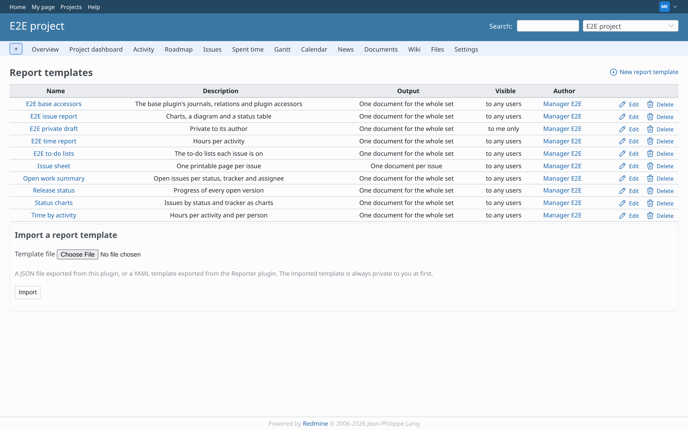 Templates: no menu item selected, no tabs | 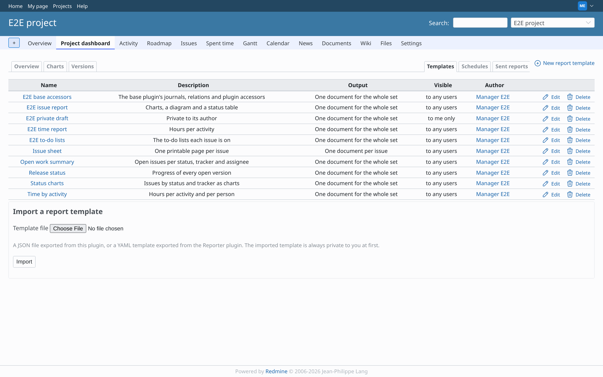 Templates: menu item selected, same tab bar |
|  Schedules |  Schedules (FR-44 warning kept, one line) |
| |  Sent reports |
| | 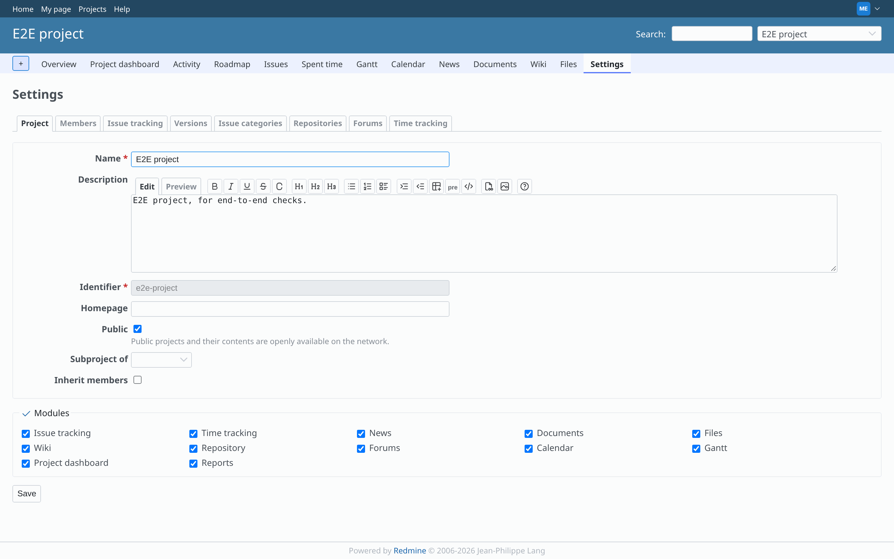 Settings without the plugin tab (choice 1c) |

Variant: two levels, as in the brief (Dashboard | Templates | Schedules | Sent reports on top,
the dashboard's pages as a second row):

| Two-level, dashboard | Two-level, templates |
|---|---|
|  | 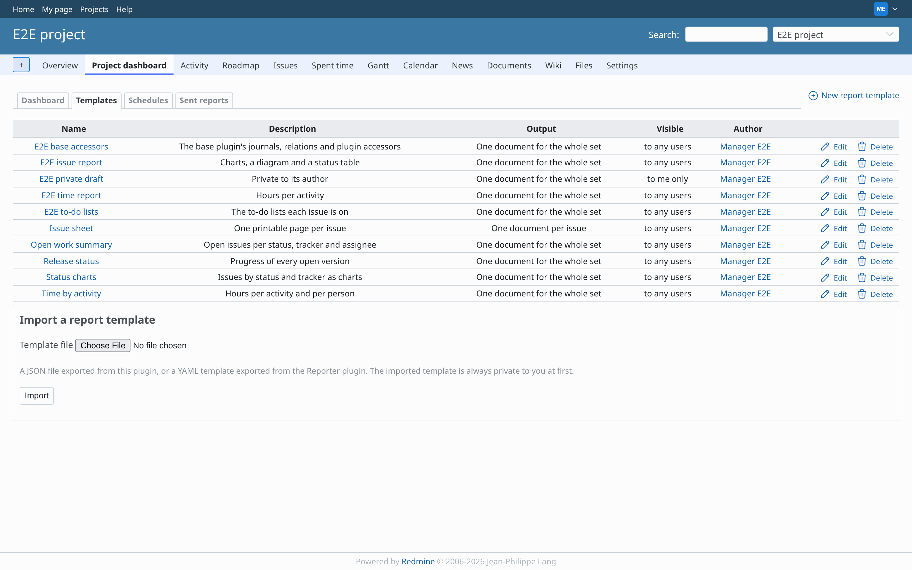 |

Menu label variant ("Project dashboard" vs "Reports"): 

**Proposal (one tab bar).**
- One project menu item (`:reporter_project_page`, same route). Selected on every subpage:
  `menu_item :reporter_project_page` in the templates, schedules, mail and share-links
  controllers (`reporter_project_pages_controller.rb:4` already has it; core idiom:
  `TimelogController` has `menu_item :time_entries`).
- One shared partial renders core `.tabs` markup on all four pages: the dashboard's pages,
  then **Templates, Schedules, Sent reports** at the end of the same bar. Each tab is shown
  only when its action is permitted for this user in this project (the same permission
  the controller authorises).
- List pages drop their `h2` (the selected tab names the page). Subpages (new, show, edit)
  keep their `h2` under the tab bar. Action links stay in `.contextual`.
- **Access (D2).** Today the menu item needs the Dashboards module and
  `view_reporter_project_page` (`init.rb:154-161`). To keep every current way in, its
  condition becomes "the user may open at least one of the four tabs", and the item links
  to the first permitted tab. Then a role with only Reports permissions, or a project with
  Reports on and Dashboards off, still gets a menu item, landing on Templates.
- **Settings (D1, choice 1c).** Remove the "Reports and dashboards" tab. Consequences, said
  out loud: the `settings_tab: true` mapping of `projects#settings` for our permissions
  (`SETTINGS_TAB_ACTIONS`, `permissions.rb:123`) goes too, so a role holding only our permissions can no longer open
  Project settings (where there would be nothing of ours). That is a permission change and
  needs Jan's yes. If configuration ever lands there, it returns as a `remote` tab holding
  settings only.
- **Does not change:** routes, what any list shows, who can open which page (with the menu
  condition above).

**Performance.** The tab bar needs the dashboard tab titles: on the dashboard none extra; on
Templates, Schedules and Sent reports +1 indexed query
(`SELECT id, title FROM reporter_project_tabs WHERE project_id = ?`, a few rows; tabs are not
filtered per user today). `allowed_to?` is in memory. Every project settings page loses up
to 3 counts and the heartbeat check (core renders every tab's partial on every settings
page).

**Effort.** 1.5 days.

**Open choices**
- **1a. One tab bar (recommended) or two levels.** One bar: no nested tabs, one click
  everywhere, readers see only the tabs their permissions open. Two levels stack two tab bars
  on the dashboard, which core never does.
- **1b. Label: "Project dashboard" (recommended) or "Reports".** Keep what users know; switch
  only if templates and mailing become the main use.
- **1c. Settings tab: remove (recommended, reopens D1 and changes the `projects#settings`
  mapping) or keep** as a remote, configuration-only tab.

---

## 2. Yellow boxes

**Problem.** `.nodata`/`.warning` is core styling, louder on 7.0 (`--oc-yellow-1` background,
`--oc-pink-9` text). Core uses it for "No data to display" and real warnings; this plugin also
uses it for explanations and for "nothing found".

| Before | After |
|---|---|
| 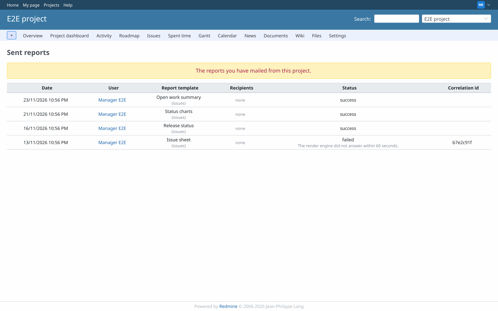 Sent reports: scope line as a yellow box | 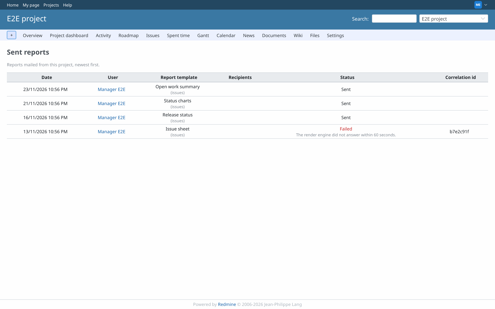 Same text, grey `em.info`; "Sent"/"Failed" |
|  Schedules: two-line notice |  Non-admin: one-line `p.warning` |
| |  Admin: same line, with a link to Render preflight |

Composite: 

**Proposal.**
- Rule: `p.nodata` only for `l(:label_no_data)`; `p.warning` for something the reader must
  know or act on; everything else `em.info`. A grep gate like
  `script/gates/chrome_no_design_tokens.sh` keeps it mechanical. About 50 places to triage
  (56 lines in `app/views` match `nodata`/`warning`, comments included).
- **Sent reports:** both scope lines stay (admin "Every report mailed from this project.",
  others "The reports you have mailed from this project."; the controller filters that way,
  `mail_controller.rb:115-123`), as `em.info`. The truncation notice ("list stops at 100",
  `mail/index.html.erb:23-30`) is a real warning: `p.warning`. Status words "Sent"/"Failed".
- **Schedules (FR-44):** the warning stays for everyone who can open the page (that is what
  `view_reporter_dashboards_schedules` is for), shortened to one line worded per state
  (`warning?` = never run, overdue or undetermined, `heartbeat.rb:86-88`), reusing existing
  text ("No scheduled report has run yet."). Non-admins: "An administrator can check the
  scheduler."; admins: a link to Render preflight, where the cron detail lives.
- Template lint "Nothing found": one grey line (finding 4).
- Widget settings with no usable template: `em.info`, with a "New report template" link for
  users who may create one.

**Performance.** None. **Effort.** 0.5 day.

**Open choice 2a.** If the Settings tab stays (1c), keep its copy of the FR-44 warning
(recommended) or leave it to the Schedules page only.

---

## 3. Dashboard widgets

**Problem.** The outer frame is core's. Inside it: a second dark-bordered frame, a card border
per table/chart, the title twice ("Open work summary (E2E project | UX open issues ) (38)" and
"Issue report — E2E project"), Arial and underlined links in a Noto page, charts 640 px wide in
full-width cards, a resize grip, degradation notes as a bold block on top, and unconfigured
widgets as a full settings form.

| Before | After |
|---|---|
|  Overview, 2396 px | 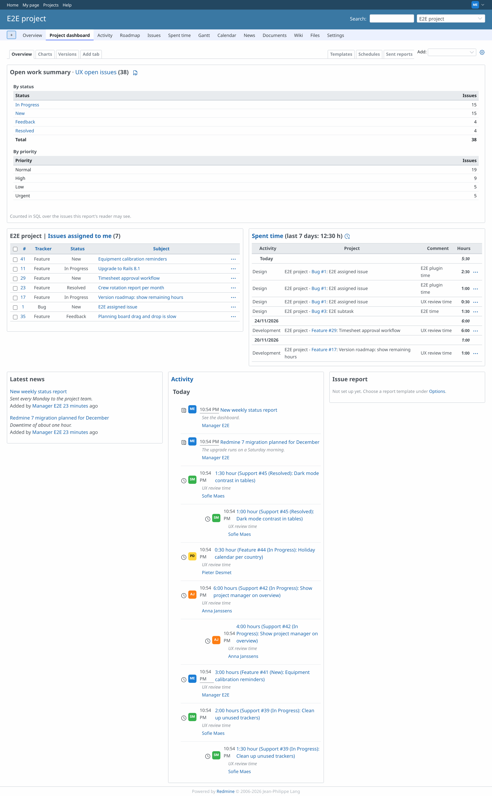 Overview, about 2300 px |
| 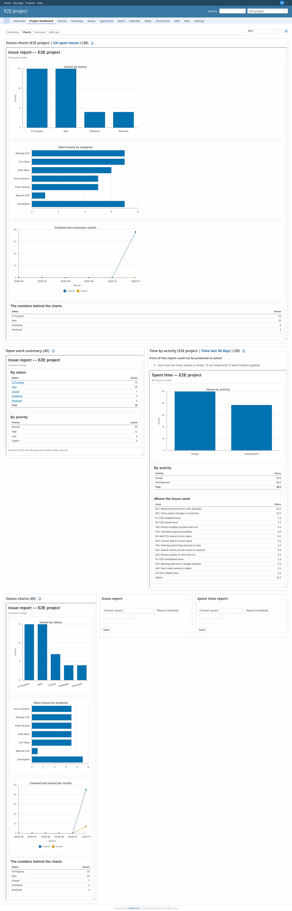 Charts, 4485 px | 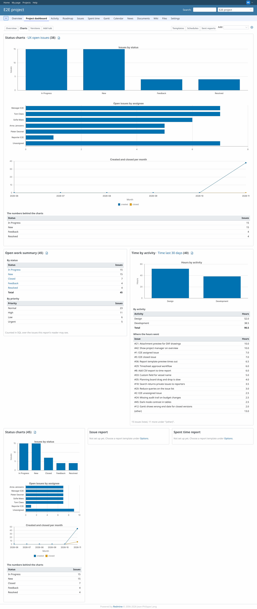 Charts, about 3400 px |
| 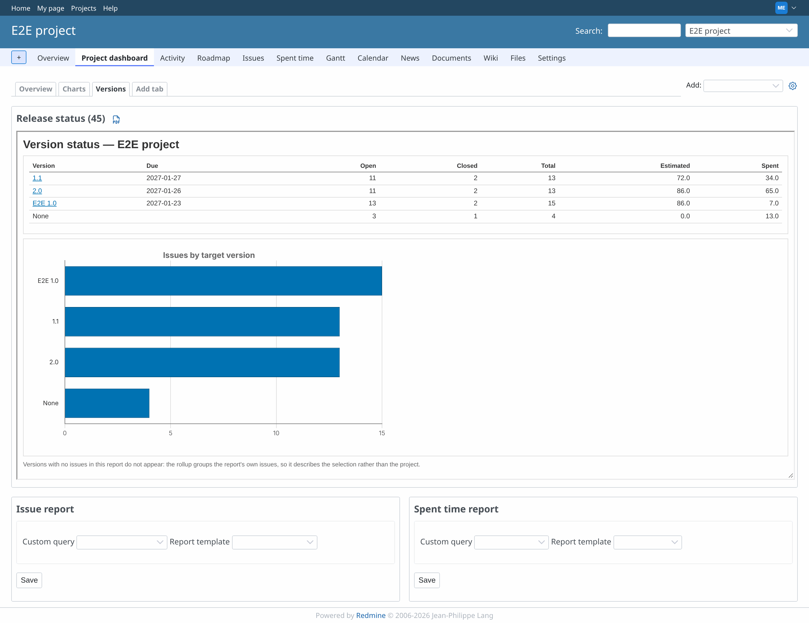 Versions, 1110 px |  Versions, 900 px |

Single widgets:

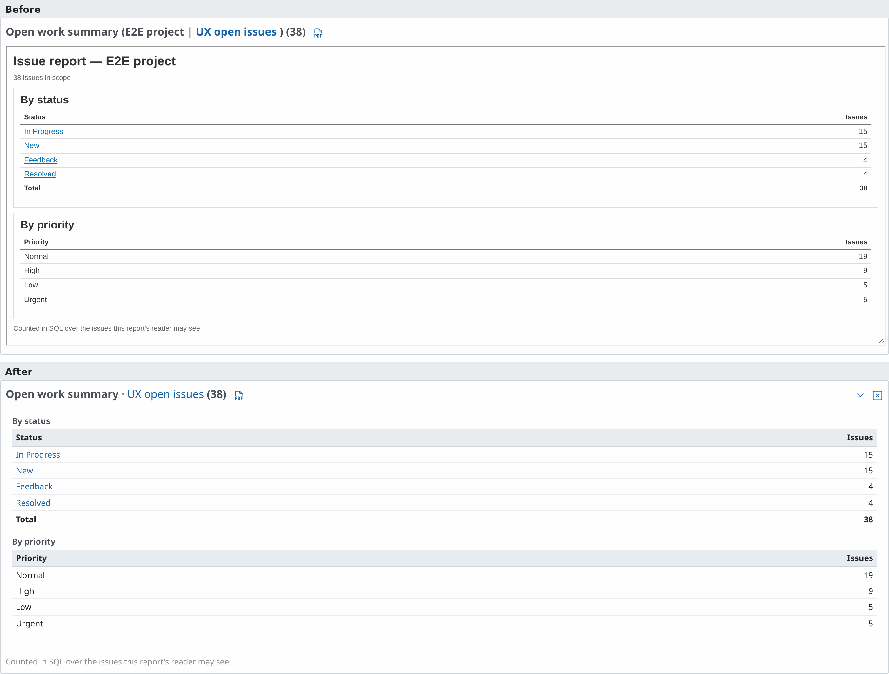
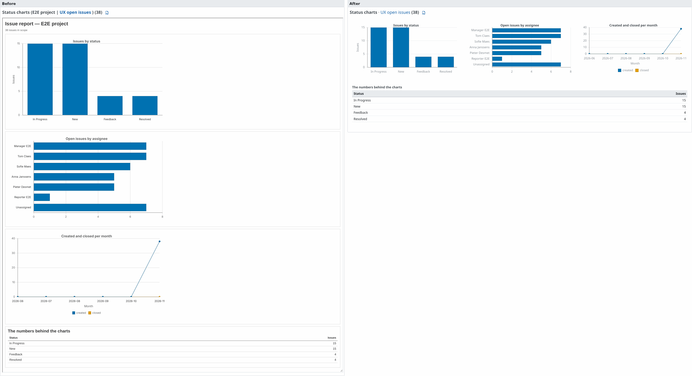


Reader `viewer` (no edit rights, own time entries only):

| Before | After |
|---|---|
| 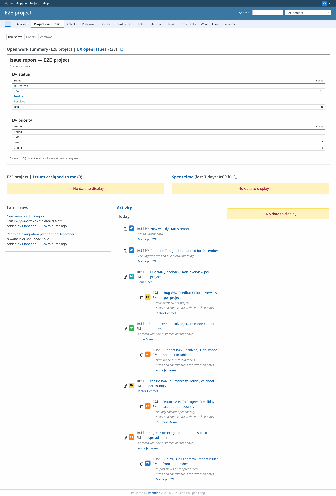 unconfigured widget = untitled yellow box | 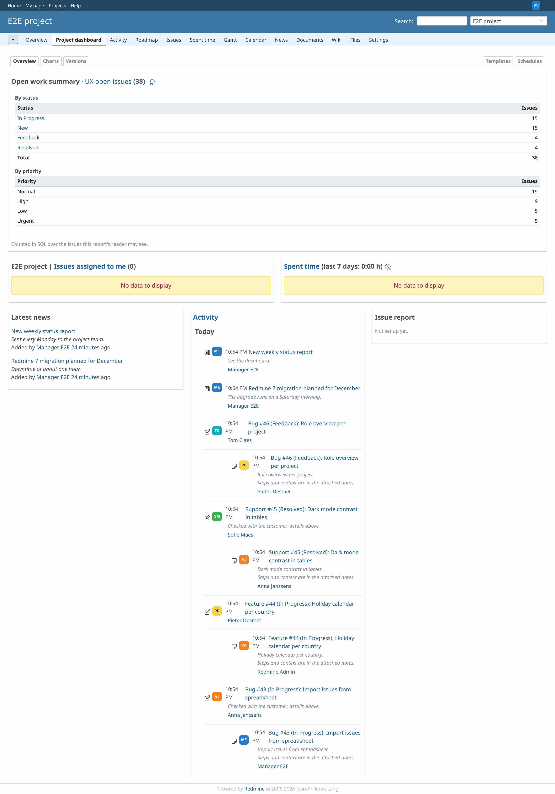 "Issue report / Not set up yet." |
| 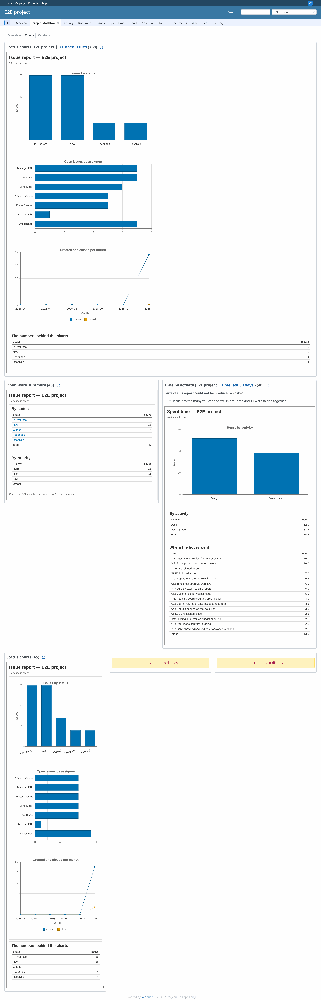 | 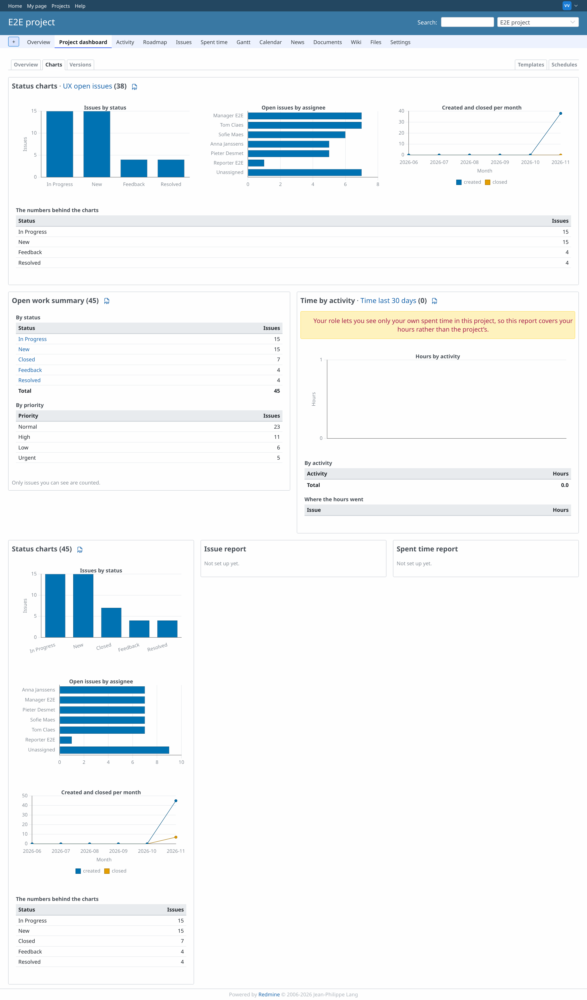 |

The S-14 narrowing notice stays exactly as today (visible, `p.warning`):
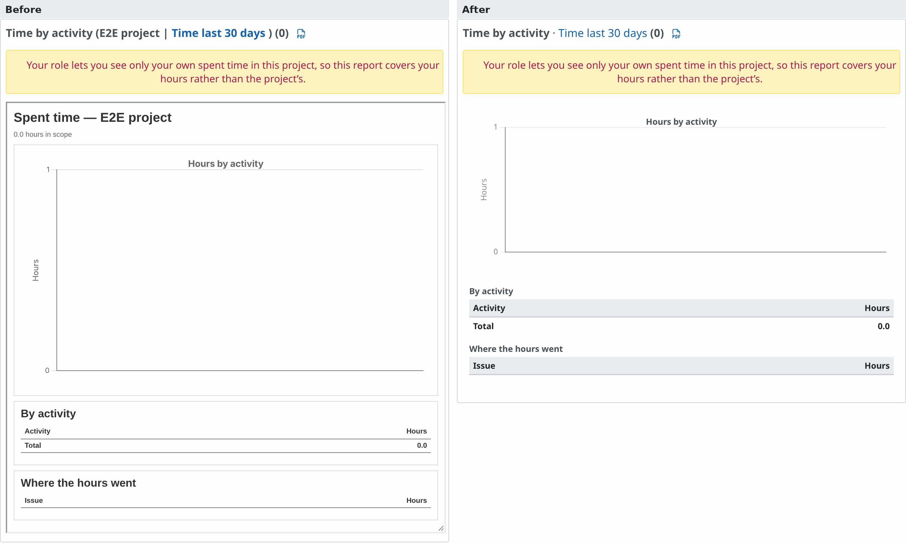

**Proposal.**
- **Outer frame unchanged** (core `.mypage-box`).
- **One heading:** `Template name · <a>Query name</a> (count) [PDF]`. No project name (it is
  this project), no stray spaces. The PDF export stays visible in the heading: core hides
  `.contextual` until hover (`application.css:2074`), which suits edit controls, not a reader's
  export.
- **Report frame without chrome** (`border: 0; resize: none`), auto-height as today.
- **A widget variant of the report stylesheet** inside the frame (the frame already carries
  the CSS class constant `ReportFrame::WIDGET_CHROME`, `report_frame.rb:136`): no `h1`, no
  "N issues in scope" line (the heading has both), no `.rrd-card` borders, `h2` 13px bold
  `#495057`, links without underline in core blue, tables in `table.list` colours (header
  `#e9ecef`, 2px `#ced4da` rule), numbers right-aligned. PDF and the full report page keep
  the print stylesheet.
- **Charts laid out by the widget's width**: consecutive chart cards in a CSS grid, 3 per row
  from 1100px, 2 from 720px, else 1; a lone chart at most 720px wide; 230 to 240px high; axis
  and legend text 12px grey `#868e96`, chart title 13px `#495057` (Chart.js is already
  responsive; the fonts are chart options the report stylesheet's widget variant sets). See
  [final/dashboard-charts.png](img/final/dashboard-charts.png).
- **Scope and degradation lines as one grey foot line, for every reader.** "Counted in SQL
  over the issues this report's reader may see." is a visibility disclosure (same family as
  S-14) and comes from the template, so it is styled, not hidden, and reworded to "Only
  issues you can see are counted." (see Final design for the render-as caveat). Degradations read plainly:
  "15 issues listed, 11 more under "(other)"." instead of a bold block on top.
- **Unconfigured widget**: editor: heading + "Not set up yet. Choose a report template under
  Options." and the core gear (`icon-settings`) in `.contextual` toggling the existing form.
  Reader: heading + "Not set up yet." (today: no heading, yellow box).
- **Does not change:** what a widget computes, for whom, the PDF, the sandbox, the S-14
  notice, the CSP (unless choice 3c option 2).

**Performance.** No queries added. For editors only, today every unconfigured widget runs
`IssueQuery.visible` and the template list on each page view
(`report_blocks/_report_by_issues.erb:35-43`); loading the form on demand (`remote`, one
request per click) saves those. Readers are unaffected.

**Effort.** 3 days.

**Open choices**
- **3a. Scope line in a widget: grey foot line (recommended)** or hidden behind an icon for
  editors only (not recommended: it is a disclosure, and a `title` tooltip is out of reach
  for keyboard and touch).
- **3b. Unconfigured widget for readers: one grey line (recommended)** or hidden.
- **3c. Font inside the report frame.** Noto Sans is ~215 KB per weight and the CSP has no
  `font-src`; the mockup embeds it only for the screenshot. (1) **System font stack**
  `"Noto Sans", system-ui, sans-serif` (recommended: zero bytes, close to Redmine
  everywhere); (2) a Latin subset of Noto Sans Regular+Bold embedded (~60 KB per widget,
  `font-src data:`); (3) keep Arial.

---

## 4. Template pages

**Problem.** "New report template" is 4535 px: starters as a bulleted list of huge
thumbnails, a small Content textarea, a yellow "Nothing found" lint box, the chart form at
the bottom, a sidebar listing 60+ accessors open.

| Before (4535 px) | After (about 1900 px) |
|---|---|
| 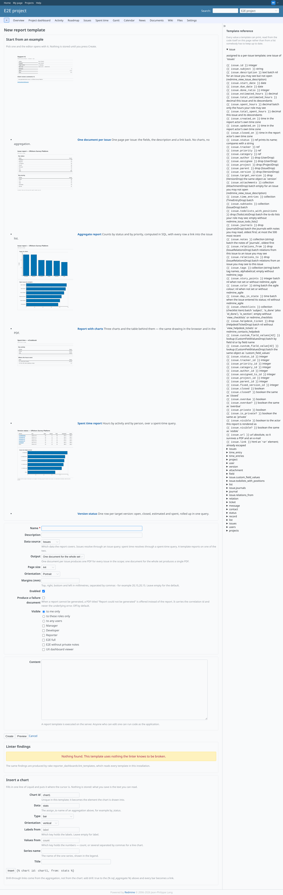 | 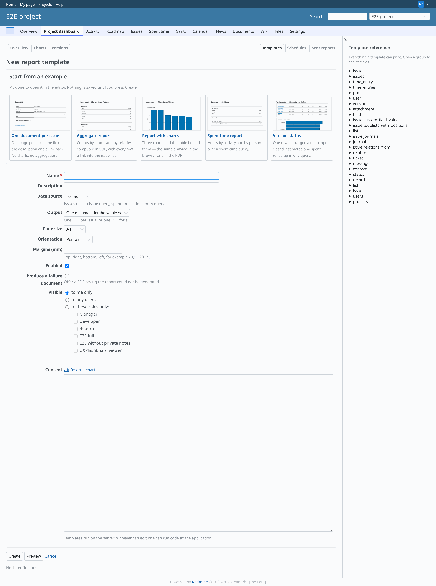 |

| Template page, editor, before | After |
|---|---|
| 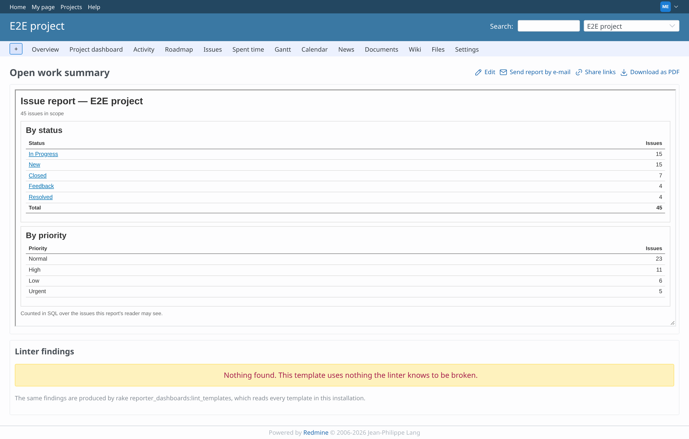 | 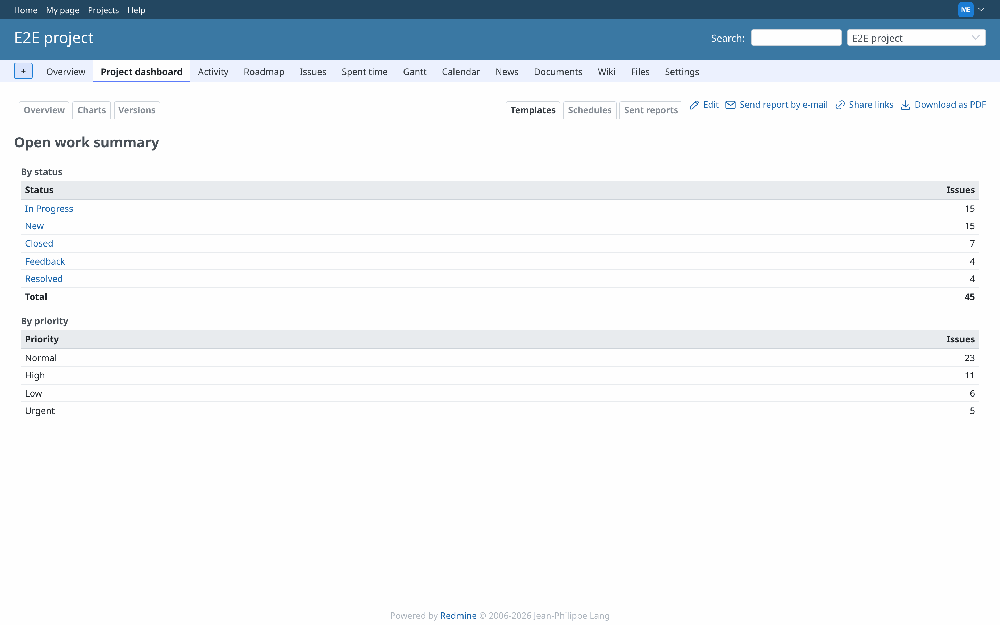 |
|  reader, before (no lint today) | 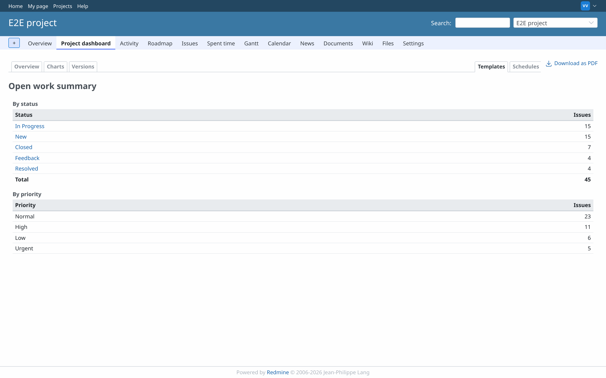 reader, after |

**Proposal.**
- **Starters as a grid of five cards** (CSS grid on the existing `ul`, thumbnail 110px high,
  name as the link, description grey). Same links (`?starter=<id>`), no JavaScript.
- **Reference collapsed**: every `<details>` closed (today the first is `open`); intro
  "Everything a template can print. Open a group to see its fields."
- **Chart helper as a button** "Insert a chart" (`icon-stats`) above the editor; it opens the
  existing (already script-driven) form as a core modal instead of a box at the bottom.
- **Larger editor**: 520px high, monospace.
- **Clean lint as one plain grey line (D4)**: "No linter findings." The line still shows
  that the linter ran (tested, :267); the rake command goes, since authors are not admins
  (test :281-285 changes with it). Findings keep today's table.
- **"Visible" exactly as core's query form**: to me only, to any users, to these roles only:,
  roles indented (`label.block.role-visibility`) and disabled until that option is chosen
  (core JS at `queries/_form.html.erb:118-121`). See
  [final/template-new.png](img/final/template-new.png).
- **Shorter help lines** under Data source, Output, Margins, "Produce a failure document".
  The INV-9 line keeps its statement: "Templates run on the server: whoever can edit one can
  run code as the application."
- Template page: the report without the `.box` and dark frame, as in the widget.

**Performance.** None (the linter still runs for editors; only the markup is smaller).
**Effort.** 1.5 days.

**Open choice 4a. Card grid (recommended)** or a "Start from" select with one small preview.

---

## 5. Admin plugin settings

**Problem.** Long help texts with internal jargon ("G7's "≈3 commands" is honestly…"), symbol
lists (":outline, :tagged_pdf").

| Before (1652 px) | After (about 1130 px) |
|---|---|
| 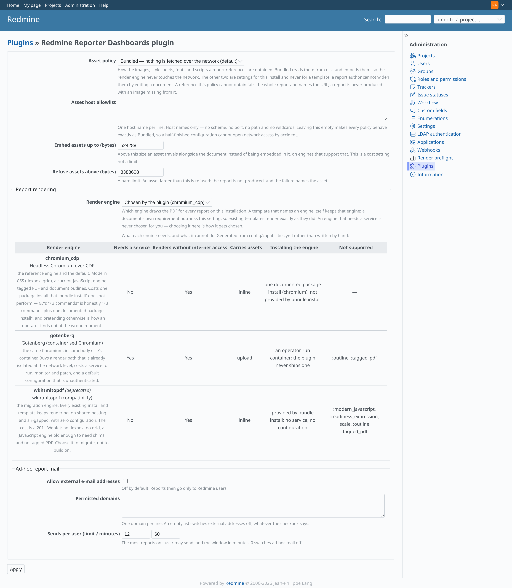 |  |

**Proposal.** One short `em.info` per field, keeping each field's essential fact (scripts
and fail-closed for Asset policy; "on engines that support it" for the embed threshold;
"0 turns ad-hoc mail off"). Engine table: engine with a one-line description, needs a
service, works offline, not supported in words ("outline, tagged PDF"); the generated
capability data stays the source (G9 unaffected, only labels change). One link to Render
preflight; the long explanations move to `docs/admin-guide.md`.

**Performance.** None. **Effort.** 0.5 day.

---

## 6. Role permission labels (D3)

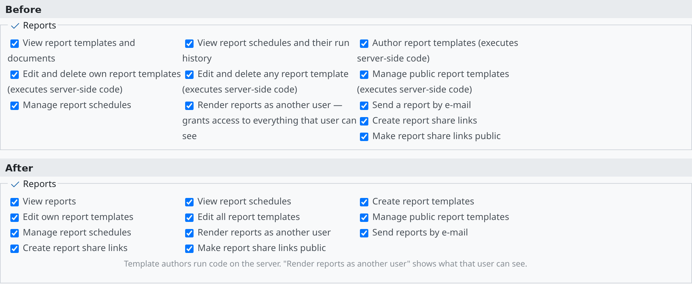

| Today | Proposed |
|---|---|
| View report templates and documents | View reports |
| View report schedules and their run history | View report schedules |
| Author report templates (executes server-side code) | Create report templates (runs code) |
| Edit and delete own report templates (executes server-side code) | Edit own report templates (runs code) |
| Edit and delete any report template (executes server-side code) | Edit all report templates (runs code) |
| Manage public report templates (executes server-side code) | Manage public report templates (runs code) |
| Render reports as another user — grants access to everything that user can see | Render reports as another user (sees all they see) |
| Send a report by e-mail | Send reports by e-mail |

The labels are locale keys (`permission_<name>`), so this is a locale change, and the
warning stays in the label itself (INV-9, `technical-spec.md:580`). The extra line under the
fieldset in the screenshot has no core place: `app/views/roles/` on 7.0 has no `call_hook`
(checked). It would need a plugin script on a core admin page; recommendation: skip it and
keep the full warning on Render preflight, which already lists the roles holding an authoring
permission.

**Performance.** None. **Effort.** 0.5 day.

---

## Open choices for Jan

| # | Choice | Recommendation |
|---|---|---|
| 1a | One tab bar or two levels | One tab bar |
| 1b | Menu label "Project dashboard" or "Reports" | Project dashboard |
| 1c | Settings tab: remove (reopens D1, changes `projects#settings` mapping) or keep config-only | Remove, with the wider menu condition |
| 2a | FR-44 warning in Settings too, if the tab stays | Yes |
| 3a | Scope line in widgets | Grey foot line for everyone |
| 3b | Unconfigured widget for readers | One grey line |
| 3c | Font in the report frame | System font stack |
| 4a | Starter gallery | Card grid |
| 6 | Shorter permission labels keeping "(runs code)" (D3) | Yes; no script on the roles page |
| 7 | Scope line wording | "Only issues you can see are counted."; in a document rendered as another user, name that user |
| 8 | Lint clean state: one grey line "No linter findings." or nothing (D4) | One grey line |

## How to reproduce

```bash
REDMINE_REPO_URL=<clone of jcatrysse/redmine> ./.codex/redmine_clone.sh 7.0-stable-GEOxyz
./.codex/test_setup.sh
./.codex/start_server.sh
(cd redmine && RAILS_ENV=production bundle exec rails runner ../docs/ux-review-2026-11/mockup/seed.rb)
node docs/ux-review-2026-11/mockup/capture.mjs          # or: capture.mjs 03 07 (by prefix)
python3 docs/ux-review-2026-11/mockup/compress.py       # composites + 256-colour PNGs
```

`seed.rb` is for a **local checkout only**: it rebuilds e2e-project's dashboard tabs when they
differ from Overview/Charts/Versions and resets the passwords of the users it creates. Dates
are relative to today, so a re-run is similar, not byte-identical.

| File | What it does |
|---|---|
| `mockup/seed.rb` | Realistic data |
| `mockup/ux.css`, `mockup/ux.js` | The "after" layer on the Redmine page (`window.UX.<step>`) |
| `mockup/report-frame.css`, `mockup/report-frame.js` | The widget variant inside the report frame |
| `mockup/capture.mjs` | Logs in per user, captures before, injects, captures after |
| `mockup/compress.py` | Composites and PNG quantisation |

The capture uses Playwright's `bypassCSP` only to inject the layer into the sandboxed frame;
full-page captures set the viewport to the page height so off-screen frames paint.

**Review.** An independent subagent reviewed the first version and rejected it: several
proposals dropped controls the spec or a curator decision requires (FR-44 warning, the
per-actor Sent reports line, the INV-9 labels, the lint clean state, the scope disclosure in
widgets) or cut access for roles without the dashboard permission. This version fixes those
in the mockup and names D1 to D4 above.
