# UX review, November 2026: design mockups

Before/after screenshots for six findings, on a real **Redmine 7.0-stable-GEOxyz** (578730a,
Rails 8.1, Ruby 3.3.6, PostgreSQL 16, production mode, Chromium) with this plugin at
`redmine70-migration`. Mockups only: **no plugin code changed**.

- **Before** is the real page.
- **After** is the same real page with a mockup layer injected by Playwright
  ([`mockup/`](mockup/)). The layer only restyles, moves or rewrites DOM the page already
  has, using Redmine's own idioms (core `.tabs`, `.contextual`, `em.info`, `p.nodata`,
  `p.warning`, `.box.tabular`, `table.list`, `.mypage-box`, `sprite_icon` ids). What you see
  can be built with core markup on Redmine 6.0 to 7.0.
- Data: 45 issues (3 trackers, 5 statuses, 4 priorities, 6 assignees, 3 versions), 49 time
  entries, 5 templates made from `starters/`, public queries, 4 sent reports, and a 3-tab
  dashboard (Overview, Charts, Versions) whose rows hold 1, 2 and 3 widgets.
- Users: `manager` (every permission), `viewer` (core Reporter + the plugin's view
  permissions, no edit rights), `admin`.
- Screenshots: 1440 wide, deviceScaleFactor 2, PNG quantised to 256 colours.

Re-run: see [How to reproduce](#how-to-reproduce).

**Constraints held by every proposal:** no change to permissions, visibility or what data
anyone sees; no page gets slower (per-proposal note); Redmine 6.0 to 7.0 core markup;
English wording proposed here, translations later.

## Summary

| # | Finding | Proposal in one line | Effort | Queries |
|---|---|---|---|---|
| 1 | Templates, Schedules, Sent reports only reachable via Settings | One menu item, one core tab bar on all four pages; Settings tab removed | 1.5 d | fewer (Settings loses 3 counts) |
| 2 | Yellow boxes used for explanations | Yellow only for no-data and real warnings; help as `em.info`; cron notice to admins only | 0.5 d | none |
| 3 | Dashboard widgets heavy and noisy | No inner frames, Redmine table idiom, one title, charts at widget width, quiet empty and technical states | 3 d | none |
| 4 | "New report template" is 4535 px | Starter cards in a grid, reference collapsed, chart helper as a button, large editor, lint only when it has findings | 1.5 d | none |
| 5 | Plugin settings full of internal jargon | One short line per field; engine table in words; details on Render preflight | 0.5 d | none |
| 6 | Permission labels too long | Short labels plus one explanatory line | 0.5 d | none |

Total about **7.5 days** including locales (12 files), tests and the four-role review.

### Corrections to the brief (measured on this branch)

1. **Linter findings on a template page are shown to editors only**, not to every viewer
   (`lint_for_editors`). `viewer` sees no lint box: [07-viewer-before-template-show.png](img/07-viewer-before-template-show.png).
   The proposal still applies to editors (hide the box when there is nothing to say).
2. **`.mypage-box` on 7.0 is not square**: 1px solid `#ced4da` (`--oc-gray-4`),
   `border-radius: 3px`, padding 8px. Identical on core My page and on the dashboard
   (same class, measured with `getComputedStyle`), so the outer frame is already core's and
   stays as it is: [03-core-my-page.png](img/03-core-my-page.png).
3. **New: a viewer sees an unconfigured report widget as an untitled yellow
   "No data to display" box** (no heading at all): [07-viewer-before-overview.png](img/07-viewer-before-overview.png), bottom right.
4. **The report frame has `default-src 'none'`**, so it cannot load Redmine's web font. See
   choice 3c.

---

## 1. Navigation

**Problem.** Only "Project dashboard" is in the project menu. Templates, Schedules and Sent
reports are reachable only via Settings > "Reports and dashboards", four fieldsets with a
count and a link each. On those pages no menu item is selected and there are no tabs
between them.

| Before | After (recommended: one tab bar) |
|---|---|
| 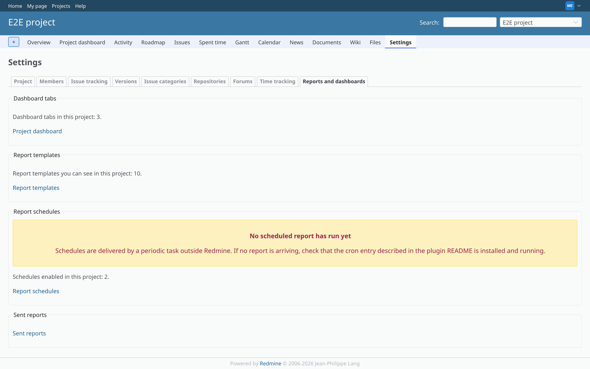 Settings tab of counts and links | 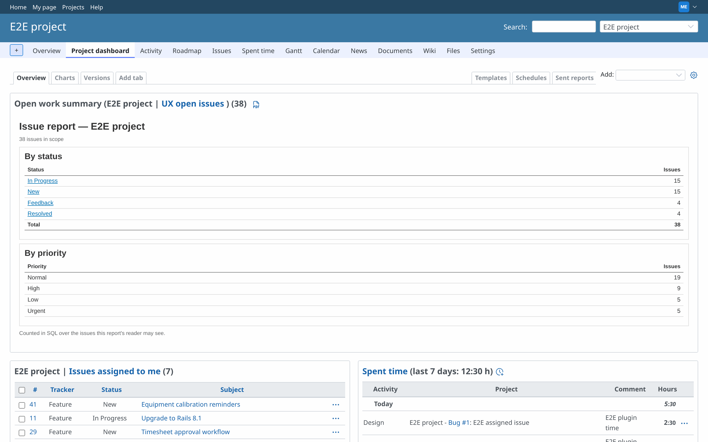 Dashboard: its pages left, management tabs right |
|  Templates: no menu item selected, no tabs |  Templates: menu item stays selected, same tab bar |
| 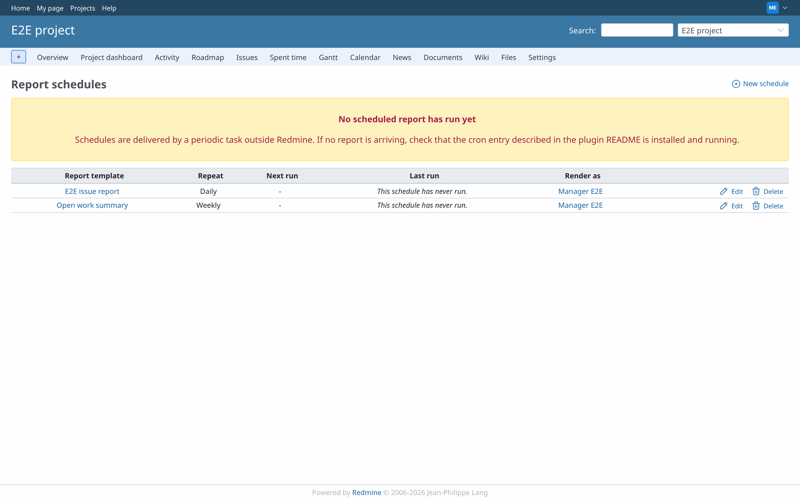 Schedules | 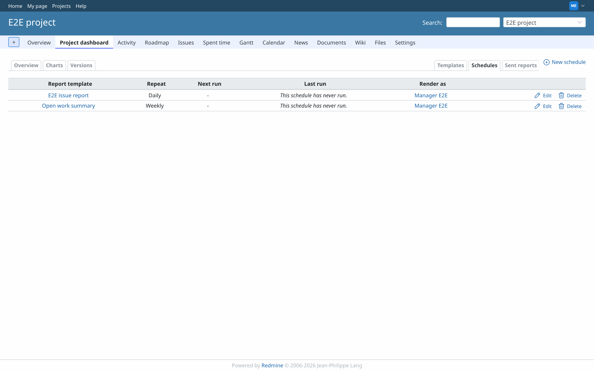 Schedules |
| | 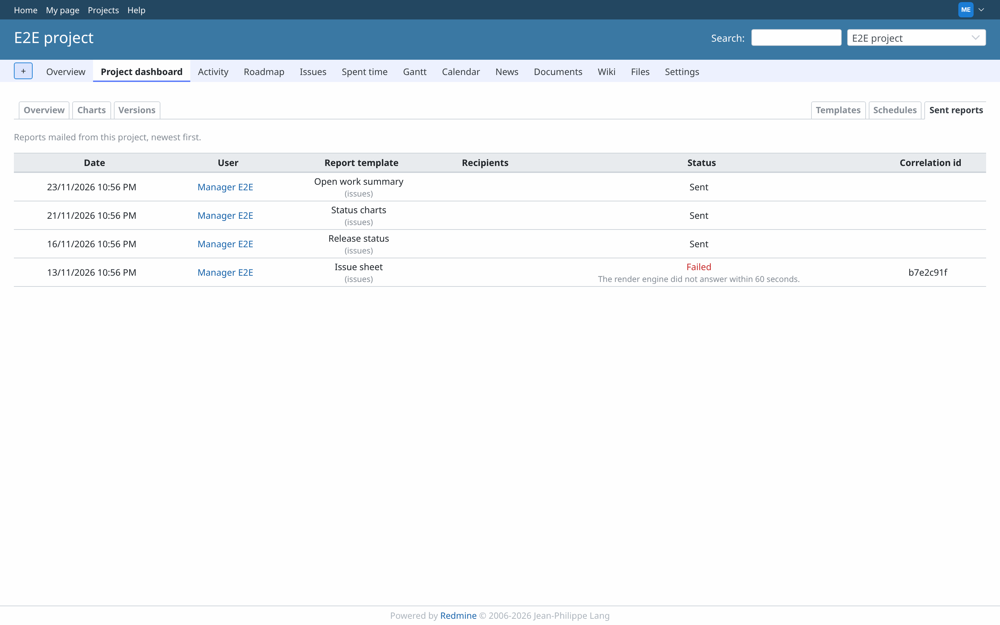 Sent reports |
| |  Settings without the plugin tab |

Variant: two levels, as described in the brief (Dashboard | Templates | Schedules |
Sent reports on top, the dashboard's pages as a second row):

| Two-level, dashboard | Two-level, templates |
|---|---|
| 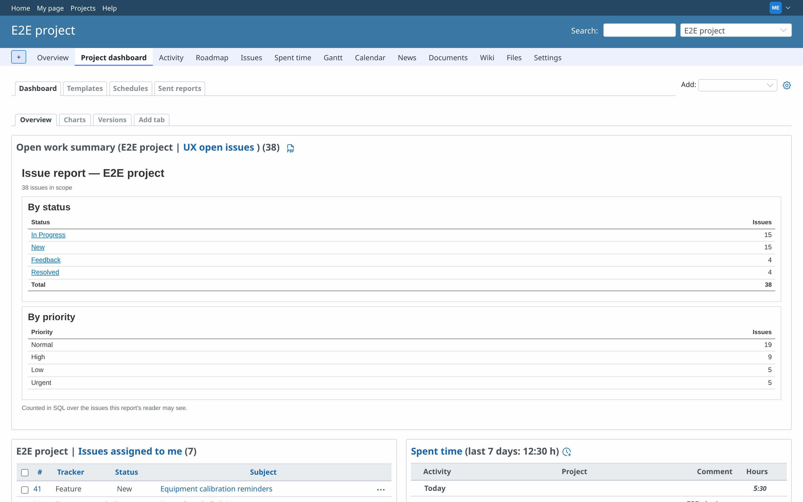 |  |

Menu label variant ("Project dashboard" vs "Reports"):
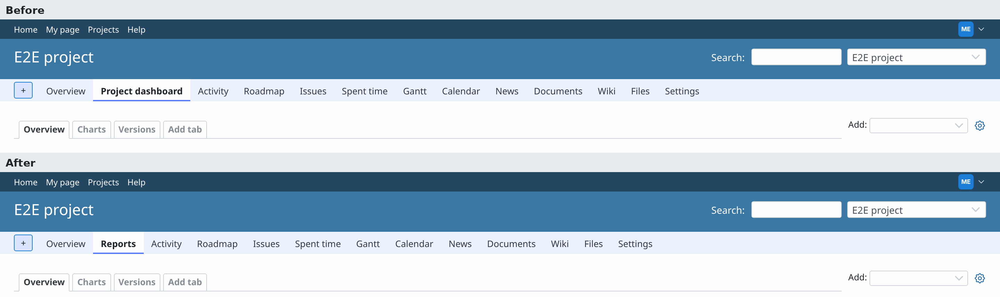

**Proposal (one tab bar).**
- One project menu item (`:reporter_project_page`, unchanged route). It is `selected` on
  every subpage: each controller sets `menu_item :reporter_project_page` (core
  `MenuManager` idiom; `TimelogController` does `menu_item :time_entries`).
- One shared partial renders core `.tabs` markup (`<div class="tabs"><ul><li><a>`, as
  `app/views/common/_tabs.html.erb` does) on all four pages: the dashboard's pages, then
  **Templates, Schedules, Sent reports** at the end of the same bar. Each management tab is
  shown only when its action is permitted (`User.current.allowed_to?(…, project)`; the same
  permission each controller already authorises). Tab order and labels are fixed.
- List pages (templates, schedules, sent reports) drop their `h2`: the selected tab names
  the page. Subpages (new, show, edit) keep their `h2` under the tab bar.
- Action links stay in `.contextual` (New report template, New schedule, Add widget).
- **Settings:** the "Reports and dashboards" tab is removed. It holds no configuration
  today, only counts and links, and core renders every settings tab's partial on every
  settings page, so removing it also removes its count queries. If configuration ever
  lands there, it comes back as a `remote` tab (content loaded on click) holding settings
  only, never a list.
- **Does not change:** routes, permissions, what any list shows. A deep link to an old
  URL still works.

**Performance.** No new queries: the tab bar needs the dashboard tab titles (one query the
dashboard page already runs; on the three management pages it is one extra
`SELECT id, title FROM reporter_project_tabs WHERE project_id = ?`, indexed, a few rows)
and `allowed_to?` checks that are in memory. Settings gets lighter.

**Effort.** 1.5 days (partial, `menu_item` in 4 controllers, settings tab removal,
locale keys, functional tests per permission combination).

**Open choices for Jan**
- **1a. One tab bar (recommended) or two levels?** One bar: no nested tabs, one click
  everywhere, a reader without management rights sees only the dashboard's pages (plus the
  tabs their permissions open). Two levels match the brief literally but stack two tab
  bars on the dashboard, which core never does.
- **1b. Menu label: "Project dashboard" (recommended, keeps what users know and says what
  most people open it for) or "Reports"** (better if templates and mailing become the main
  use).
- **1c. Settings tab: remove (recommended)** or keep as a remote tab with configuration
  only. There is no project-level configuration to put in it today.

---

## 2. Yellow boxes

**Problem.** `.nodata`/`.warning` is core styling and Redmine 7 made it louder
(`--oc-yellow-1` background, `--oc-pink-9` text). Core uses it almost only for "No data to
display" and real warnings; this plugin also uses it for explanations, for an operator
notice shown to every user, and for "nothing found".

| Before | After |
|---|---|
|  Sent reports: an explanation as a yellow box |  Grey `em.info`; "success" as "Sent", a failure in red text |
|  Schedules: cron notice to every user | 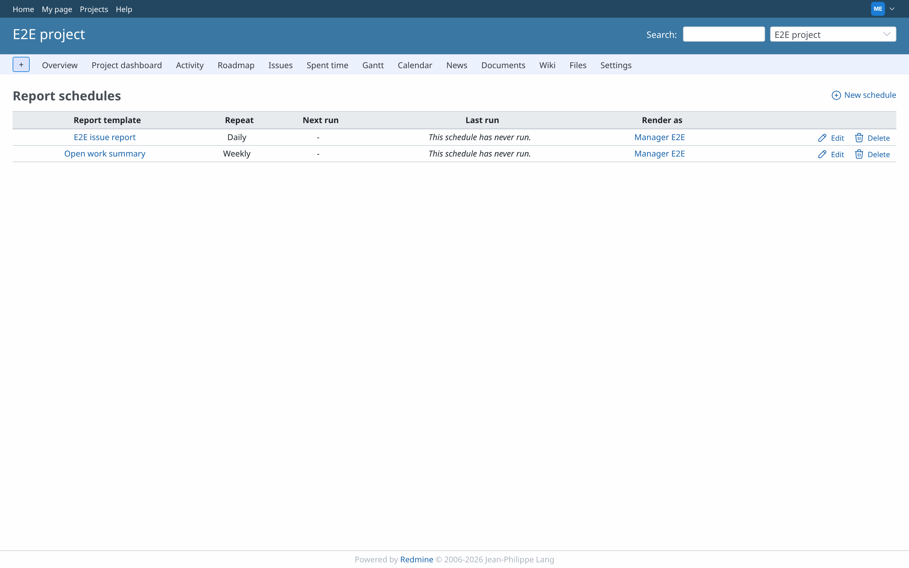 Project member: no notice |
| | 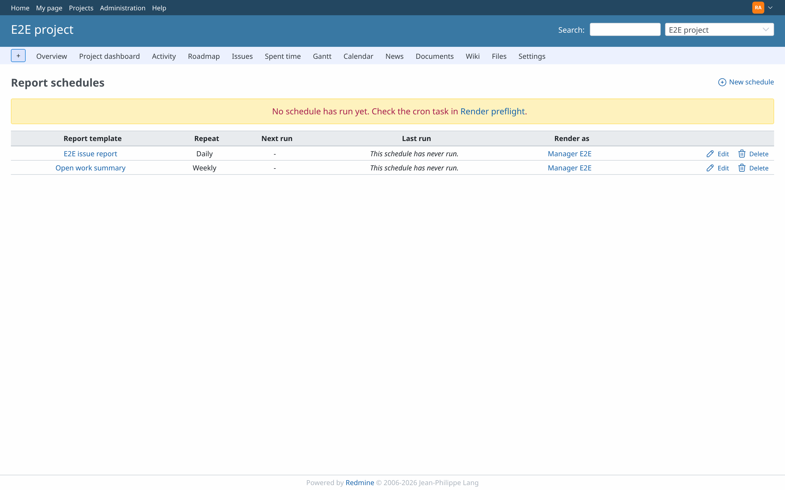 Administrator: one-line `p.warning` with a link to Render preflight |

Composite: 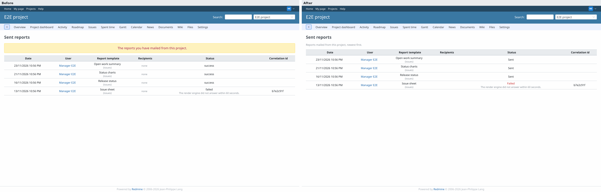

**Proposal.**
- Rule: `p.nodata` only for "No data to display" (core text `:label_no_data`);
  `p.warning` / `.flash.warning` only for something the reader must act on; everything
  else is `em.info` (grey, small, core class).
- Sent reports: "The reports you have mailed from this project." becomes
  `<p><em class="info">Reports mailed from this project, newest first.</em></p>`.
  Status words: "Sent" / "Failed" (failure in core's error colour); empty recipient cell
  instead of "none".
- Schedules: the cron notice is shown only to administrators (`User.current.admin?`), as
  one line: "No schedule has run yet. Check the cron task in Render preflight." The full
  operator text moves to Render preflight.
- Template lint: "Nothing found…" is no longer a yellow box; the panel is omitted when
  there are no findings (finding 4).
- Widget settings with no usable template ("There is no report template this widget can
  use yet…"): `em.info` with a link "New report template" for users who may create one.
- A grep-based gate (like `script/gates/chrome_no_design_tokens.sh`) keeps `nodata` to
  `l(:label_no_data)` only, so the rule stays mechanical.

**Performance.** None. **Effort.** 0.5 day (about 49 view occurrences to triage; most become
`em.info`).

**Open choice:** 2a. Admin cron notice on the Schedules page (recommended, one line, only
when no schedule has ever run or the last run is older than twice its interval) or only on
Render preflight.

---

## 3. Dashboard widgets

**Problem.** The outer frame is core's (`.mypage-box`). What makes widgets heavy is inside
it: a second dark-bordered report frame, a card border per table/chart, the title twice
("Open work summary (E2E project | UX open issues ) (38)" and "Issue report — E2E project",
with stray spaces), Arial and underlined links in a Noto page, charts 640 px wide in a full
width card, a resize grip, technical lines ("Counted in SQL over the issues this report's
reader may see."), degradation notes as a bold block on top, and unconfigured widgets as a
full settings form.

Full tabs (manager):

| Before | After |
|---|---|
| 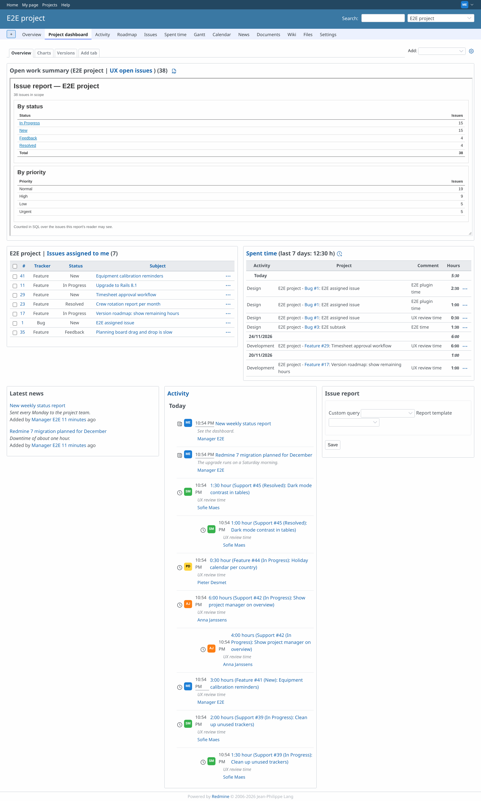 Overview, 2396 px |  Overview, 2303 px |
|  Charts, 4485 px |  Charts, 3411 px |
|  Versions, 1110 px | 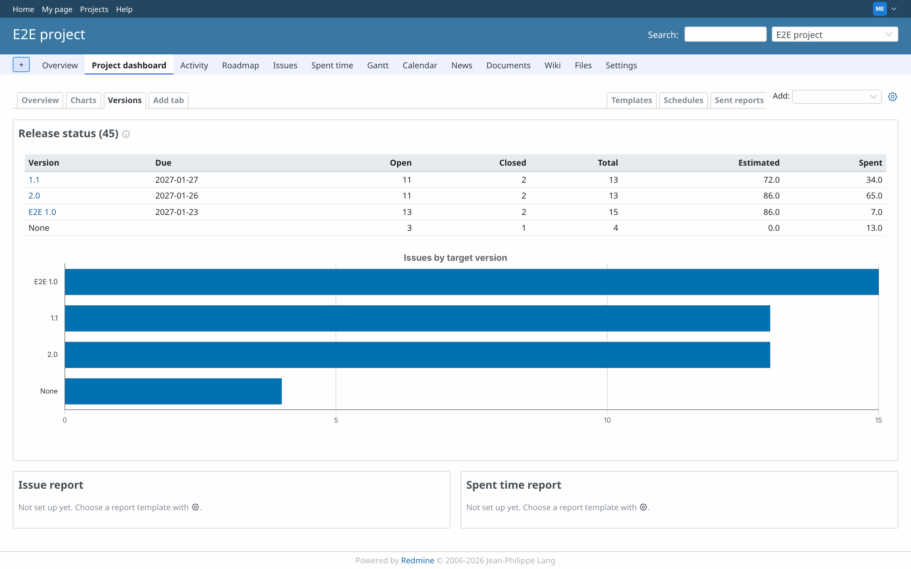 Versions, 900 px |

Single widgets (element screenshots):


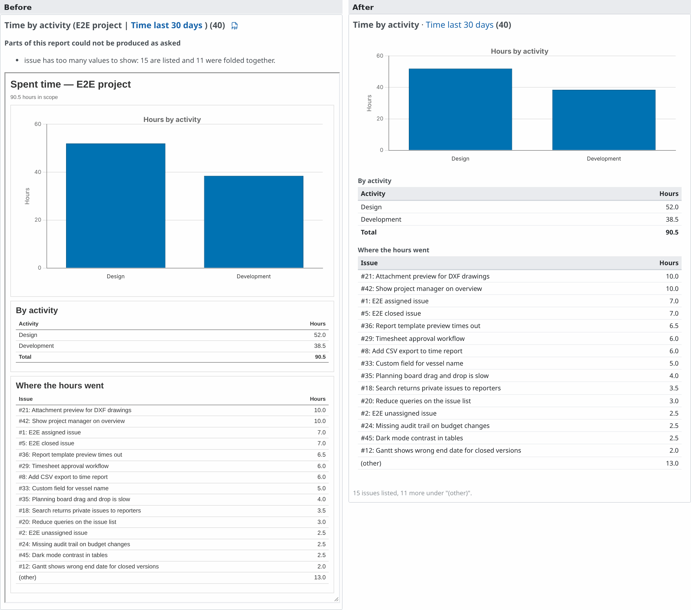
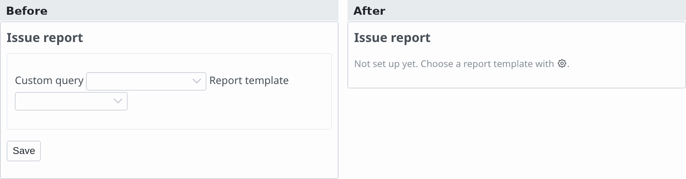

Reader without edit rights (`viewer`):

| Before | After |
|---|---|
|  unconfigured widget = untitled yellow box |  "Issue report / Not set up yet." |
|  |  |

**Proposal.**
- **Outer frame unchanged** (core `.mypage-box`, same as My page).
- **Heading, one line, core style:** `Template name · <a>Query name</a> (count)`. No project
  name (it is this project; core's own query block shows it only on My page, which spans
  projects). Count without spaces inside the parentheses. Without a query:
  `Template name (count)`.
- **Controls in `.contextual`**: PDF export joins move/remove there; core shows
  `.mypage-box > .contextual` on hover (`application.css:2074`), as on My page.
- **Report frame without chrome** (`border: 0; resize: none`), auto-height as today.
- **A "widget" variant of the report stylesheet** inside the frame
  (`ReportFrame::WIDGET_CHROME` already exists as a class): no `h1` and no "N issues in
  scope" line (the heading has both), no `.rrd-card` borders, `h2` at 13px bold
  `#495057`, links without underline in core blue, tables in core `table.list` colours
  (header `#e9ecef`, 2px `#ced4da` rule, row lines `#e9ecef`), numbers right-aligned.
  The PDF and the full report page keep the print stylesheet (§9b: one type scale; the
  widget variant only removes chrome and sets colours).
- **Charts at the widget's width**: `max-width` removed on `.rrd-chart-frame`; height by
  widgets in the row: 1 = 300px, 2 = 260px, 3 = 220px (Chart.js is already responsive).
- **Technical notes hidden for readers**: the "how it was counted" lines are marked in the
  stylesheet (e.g. `.rrd-note`) and hidden in the widget; an editor gets one `help` sprite
  icon in the heading whose tooltip holds them.
- **Degradations**: one grey `em.info` line under the report, for every reader (it is a
  fact about the numbers on screen), worded plainly: "15 issues listed, 11 more under
  "(other)"." instead of a bold block on top. The time-entry visibility notice
  (`p.warning`, S-14) stays as it is: that one must stay visible.
- **Unconfigured widget**: editor: heading + `em.info` "Not set up yet. Choose a report
  template with ⚙." and a gear (`icon-settings`, as core blocks use) in `.contextual` that
  toggles the existing form (`$('#…-settings').toggle()`, the core block idiom). Reader:
  heading + "Not set up yet." (today: no heading, yellow box).
- **Does not change:** what a widget computes, for whom, the PDF, the sandbox and CSP
  (except possibly `font-src`, choice 3c).

**Performance.** No queries added. Rendering gets cheaper (fewer nodes; no settings forms
with query and template selects for unconfigured widgets until opened; today each
unconfigured widget renders `IssueQuery.visible` and the template list on every page view,
so making the form load on demand (`remote`) would save those queries).

**Effort.** 3 days (stylesheet variant + its spec, heading partial, widget states, on-demand
settings form, chart sizing, tests for editor/reader states, locales).

**Open choices for Jan**
- **3a. Technical notes for readers: hide (recommended)** or keep as a small grey line.
- **3b. Unconfigured widget for readers: one grey line (recommended)** or hide the widget
  entirely for readers.
- **3c. Font inside the report frame.** The frame's CSP is `default-src 'none'` and Noto
  Sans is ~215 KB per weight, so the mockup embeds it only for the screenshot. Options:
  (1) **system font stack** `"Noto Sans", system-ui, sans-serif` (recommended: zero bytes,
  close to Redmine everywhere, exact where Noto is installed); (2) embed a Latin subset of
  Noto Sans Regular+Bold (~60 KB per widget, needs `font-src data:`), exact match but
  every widget gets heavier; (3) keep Arial.
- **3d. Degradation line for every reader (recommended)** or only for editors as the brief
  suggested. Recommendation follows the existing code's reasoning: truncation changes the
  numbers the reader sees.

---

## 4. Template pages

**Problem.** "New report template" is 4535 px: starter gallery as a bulleted list of huge
thumbnails, then the form, a small Content textarea, a "Linter findings" box that says
"Nothing found", an "Insert a chart" form at the bottom and a sidebar listing 60+ accessors
open.

| Before (4535 px) | After (1906 px) |
|---|---|
|  |  |

| Template page before (editor) | After |
|---|---|
|  report in a dark frame, lint box with rake command |  report without frame, no lint box (no findings) |
| 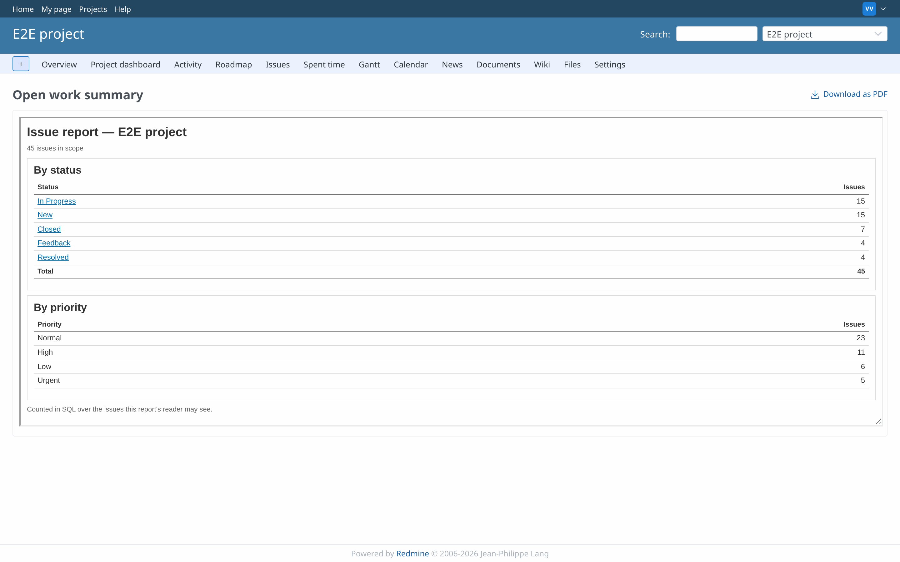 reader: no lint box today |  reader after |

**Proposal.**
- **Starter gallery as a grid of five cards** (CSS grid on the existing `ul`, thumbnail
  110px high, `object-fit: cover`, name as the link, description as grey text). Same
  links (`?starter=<id>`), no JavaScript.
- **Reference sidebar collapsed**: every `<details>` closed by default (today the first is
  `open`), intro "Everything a template can print. Open a group to see its fields." The
  sidebar is then a 25-line index.
- **Chart helper as a button** "Insert a chart" (`icon icon-stats`) directly above the
  editor; it opens the existing form (already `hidden` and script-driven) as a core modal
  (`showModal`) instead of a box at the bottom.
- **Larger editor**: 520px high, monospace.
- **Lint only when there are findings** (editors only, as today); the rake hint moves to the
  admin guide.
- **Shorter help lines** under Data source, Output, Margins, "Produce a failure document";
  "A report template is executed on the server. Anyone who can edit one can run code as
  the application." becomes "Templates run on the server." (the permission label and
  Render preflight carry the full warning, finding 6).
- Template page: the report without the `.box` and dark frame, as in the widget; actions
  stay in `.contextual`.

**Performance.** None (same render; the hidden lint box is not rendered at all).
**Effort.** 1.5 days.

**Open choice:** 4a. **Card grid (recommended)** or a "Start from" select with one small
preview. The grid keeps the thumbnails, which is what makes the starters understandable.

---

## 5. Admin plugin settings

**Problem.** Long help texts with internal jargon ("G7's "≈3 commands" is honestly…"),
symbol lists (":outline, :tagged_pdf").

| Before (1652 px) | After (1129 px) |
|---|---|
|  | 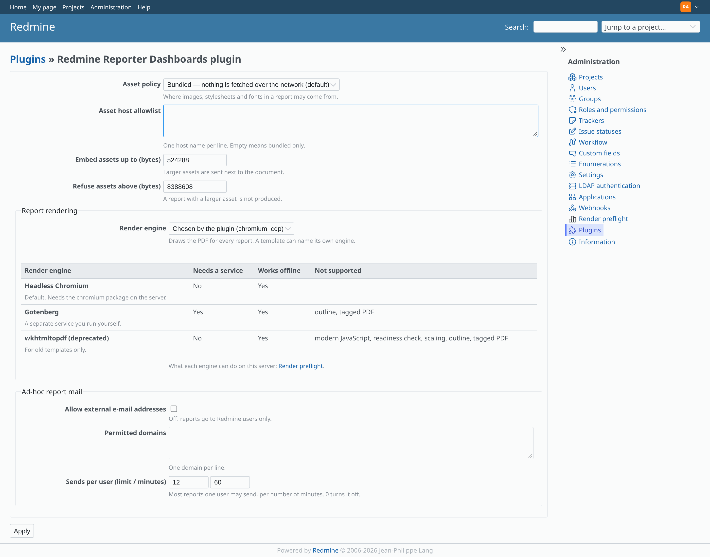 |

**Proposal.** One short `em.info` line per field (wording in the screenshot). Engine table:
four columns (engine with one-line description, needs a service, works offline, not
supported in words: "outline, tagged PDF"), the generated capability data stays the source,
only its presentation changes. One link "What each engine can do on this server: Render
preflight." The long explanations move to `docs/admin-guide.md`.

**Performance.** None. **Effort.** 0.5 day. **Note:** the engine table is generated from
`config/capabilities.yml`; G9 (matrix generated from the run) is unaffected because only
labels change, not the data.

---

## 6. Role permission labels


| Today | Proposed |
|---|---|
| View report templates and documents | View reports |
| View report schedules and their run history | View report schedules |
| Author report templates (executes server-side code) | Create report templates |
| Edit and delete own report templates (executes server-side code) | Edit own report templates |
| Edit and delete any report template (executes server-side code) | Edit all report templates |
| Manage public report templates (executes server-side code) | Manage public report templates |
| Render reports as another user — grants access to everything that user can see | Render reports as another user |
| Send a report by e-mail | Send reports by e-mail |

Plus one line under the Reports fieldset: *"Template authors run code on the server.
"Render reports as another user" shows what that user can see."*

**Buildable?** The permission labels are locale keys (`permission_<name>`), so the short
labels are a locale change. The explanatory line has no core place: `app/views/roles/` on
7.0-stable-GEOxyz contains no `call_hook` (checked). Options: (a) a small script in the
plugin's assets that appends the line to the Reports fieldset (works, but it is a
plugin script on a core admin page), (b) put the warning in Render preflight, which already
lists which roles hold an authoring permission. **Recommendation: short labels + (b).**
**Effort.** 0.5 day. **Performance.** None.

---

## Open choices for Jan (all in one place)

| # | Choice | Recommendation |
|---|---|---|
| 1a | One tab bar or two levels | One tab bar |
| 1b | Menu label "Project dashboard" or "Reports" | Project dashboard |
| 1c | Settings tab: remove or remote config-only tab | Remove |
| 2a | Cron notice: admins on Schedules page, or Render preflight only | Admins, one line, only when overdue |
| 3a | Technical notes for readers | Hide; help icon for editors |
| 3b | Unconfigured widget for readers | One grey line |
| 3c | Font in report frame | System font stack (no bytes added) |
| 3d | Degradation line | For every reader, one grey line |
| 4a | Starter gallery | Card grid |
| 6 | Explanatory line on the role form | Short labels; warning on Render preflight |

## How to reproduce

```bash
REDMINE_REPO_URL=<clone of jcatrysse/redmine> ./.codex/redmine_clone.sh 7.0-stable-GEOxyz
./.codex/test_setup.sh
./.codex/start_server.sh
(cd redmine && RAILS_ENV=production bundle exec rails runner ../docs/ux-review-2026-11/mockup/seed.rb)
node docs/ux-review-2026-11/mockup/capture.mjs          # or: capture.mjs 03 07 (by prefix)
python3 docs/ux-review-2026-11/mockup/compress.py       # composites + 256-colour PNGs
```

| File | What it does |
|---|---|
| `mockup/seed.rb` | Realistic data (idempotent, keeps tab ids stable) |
| `mockup/ux.css`, `mockup/ux.js` | The "after" layer on the Redmine page (`window.UX.<step>`) |
| `mockup/report-frame.css`, `mockup/report-frame.js` | The widget variant inside the report frame |
| `mockup/capture.mjs` | Logs in per user, captures before, injects, captures after |
| `mockup/compress.py` | Composites and PNG quantisation |

Mockup notes: the capture uses Playwright's `bypassCSP` only to inject the layer into the
sandboxed frame; full-page captures set the viewport to the page height so off-screen
frames paint. The review of this document was done by an independent subagent; see the
commit message.
